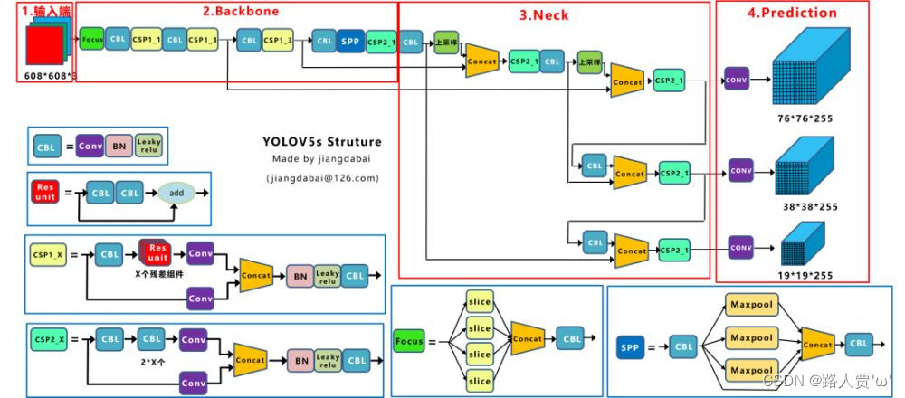

* **模型架构与演进路径**：
  * 经典多阶段 vs 单阶段：Faster R-CNN（RPN、RoI Pooling/Align）对比 YOLOv5/v8（单阶段高效预测）。
    * Faster R-CNN
        * 骨干网络
            * 用于特征提取，产生(B,C,H,W)的特征图，作为PRN,RoI Pooling/Align的输入
        * PRN
            * 目标是得到候选框的坐标。
            * 预设A个锚框，分为分类分支，回归分支在特征图上1*1卷积，分别得到 (B,AHW，2)的背景/物体分类得分和(B,AHW,4)的锚框dx,dy,dw,dh的偏移量.
            * 每张特征图内解码为AHW个框，裁剪边界外的框，过滤小于阈值的框，按前景得分排序排除分低的框，NMS不分类别过滤，取前几的框(R,4)（R为batch索引,4是绝对坐标）输入下一阶段
        * RoI Pooling/Align
            * 目标是由共享特征图和PRN的建议得到分类结果.
            * 使用PRN的输出的(R,4),由原始图片坐标投影到特征图坐标，在坐标范围内划分(7,7)的bin,每个块进行max/avg pooling ，得到(B,R,C,7,7)的固定尺寸特征图，接入全连接层得到具体的分类结果和每个box的偏移量。
    * YOLOv5
      
      * 骨干网络
        * CBS = Conv2d + BatchNorm2d + SiLU
        * C3 通道分2组，分别进过1，1卷积控制通道数，一组经过n个瓶颈块，一组在通道维度拼接到另一组的输出,最后进过1*1卷积控制通道数
        * SPPF
          * 目标是多尺度特征融合
          * 先进过1,1卷积降低通道数，通过3个串行的5*5 maxpooling,输出为3层输出+输入第一层pooling的输入的通道拼接后经过CBS进行通道融合

      * 颈部网络
        * 骨干网络输出 P3/P4/P5 三个不同大小的特征图
        * FPN
          P5->P4->P3 依次上采样，通道拼接，C3模块融合通道,输出F4,F3
        * PAN
          F3->F4->F5 依次下采样(步长2的CBS)，通道拼接，C3模块融合通道,输出N4,N5
        * F3,N4,N5  小，中，大目标检测头
      * 检测头
        * 耦合头，每个位置输出3个锚框*(4个锚框漂移参数+1存在目标的置信度+numclass)
    * YOLOv8
      * C2f取代C3：每个bottleneck的特征都参与拼接而不是最后一个bottleneck的特征
      * head使用分类回归解耦头,回归分支直接预测回归偏移量并计算概率偏移量概率分布
      * DFL 预测框边界的分布区间的概率
  * 现代与前沿架构：YOLOv10 / YOLOv11（无 NMS 端到端优化、双重标签分配）、RT-DETR（实时 Vision Transformer 目标检测器架构）。
    * YOLOv10
      * SCDown 空间通道解耦下采样
        * 1* 1 卷积 + 3* 3 s=2 dw卷积
      * C2fCIB 跨阶段分瓶颈块升级
        * C2f 内部瓶颈块替换为深度可分离卷积
      * PSA 部分自注意力
        * SPPF后，通道分组一组进过MHSA+FNN，一组直接通过，最后特征拼接
      * 双头设计,一致双分配(一对一头，一对多头)
        * 训练时双头联合优化，推理只使用一对一头->NMS-Free
    * YOLOv11
      * C3k2取代C2f
        * 可变卷积核大小
      * C2PSA 增强的空间注意力
      * 检测头使用DW卷积
      * 后处理保留NMS
    * RT-DETR
      * 高效混合编码器，只针对高层特征做自注意力机制(AIFI)
      * CCFM 
      * IOU感知选择
        * 分类得分 * IOU得分 初始化查询
      * 可裁剪解码器层数与每层的辅助预测头