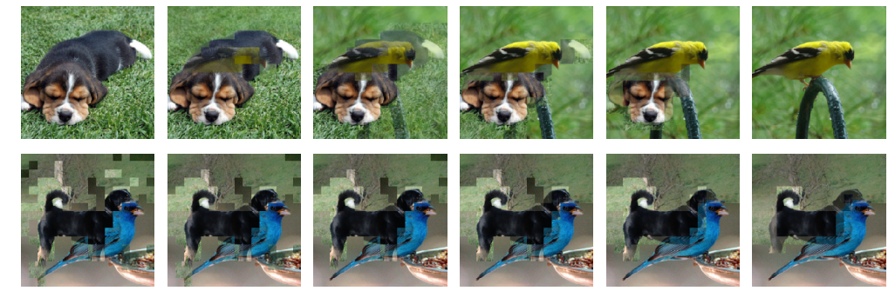
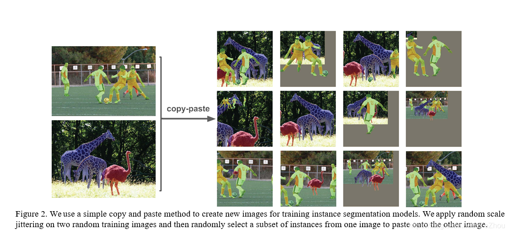

* **训练技巧**：Mosaic、MixUp、Copy-Paste 数据增强；EMA（指数移动平均）；余弦退火学习率调度。
    * Mosaic
        多张图像随机缩放，裁剪后拼接成一个大图
        
    * MixUp
        两张图像按比例线性混合，标签也混合
        
    * Copy-Paste
        从一张图复制目标实例，黏贴到另一张图随机位置
        
    * EMA
        维护模型参数的滑动平均样本，仅参与推理/验证
    * 余弦退火学习率调度
        $η_t=η_{min}+\frac{1}{2}(η_{max}-η_{min}(1+cos\frac{tπ}{T}))$